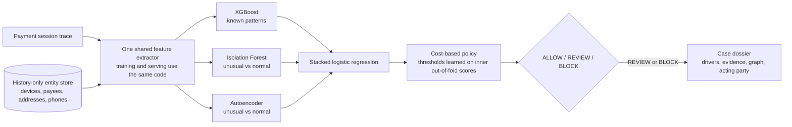

# AI Defence System (v2): a layered payment-fraud risk prototype, evaluated honestly on synthetic data

**What this is.** A prototype that scores a payment-session "trace" and returns ALLOW / REVIEW / BLOCK with an explanation.
It combines a supervised model for known fraud patterns, two novelty detectors for unusual behaviour, history-only graph features
(shared devices, payees, addresses, phones), and a cost-based decision policy. Every result in this repository is on **synthetic data**.

**What this is not.** It does not detect real-world fraud, and it does not yet legitimately claim to detect GenAI-era fraud.
The "GenAI-era" families are my own lightweight simulations of behaviour (for example KYC telemetry, not images or video). The honest claim is:
*a layered fraud-risk prototype with unseen-fraud evaluation on synthetic data.*

## Headline results (all synthetic; produced by the scripts listed under "Reproduce")

| | v1 as I first reported it | v1 re-run, customer-grouped folds | v2 World A (v1 attacks) | v2 World B (harder, 4 new families) |
|---|---|---|---|---|
| F1 | 0.976 | 0.981 +/- 0.001 | 0.975 +/- 0.003 | 0.824 +/- 0.012 |
| Recall | 0.968 | - | 0.973 [0.957, 0.987] | 0.780 [0.738, 0.824] |
| Precision on the synthetic mix | 0.984 | - | 0.970 | 0.882 |
| Precision at an assumed 0.6% fraud rate | not reported | not reported | 0.401 [0.273, 0.577] | 0.103 [0.077, 0.141] |

How to read it: the first column is the number I originally put in the v1 README (the Stage 1 + 2 cascade on all 1,556 traces). The second column is a different,
simpler model (single-stage XGBoost, all 28 features) re-run with customer-grouped folds, so it is not an exact like-for-like. On the SAME attacks (World A) the score
barely moves: **fixing customer leakage and in-fold tuning did not change the picture**. The big drop appears only in World B, where legitimate traffic includes hard
cases and some attackers adapt. That drop is the finding: it shows how much of a high score came from an easy simulator.
At a realistic fraud rate, most flags in the hard world are false alarms (precision about 0.10).

## Real vs offline vs served (read this before trusting any claim)

| Component | Status |
|---|---|
| Red Team simulator (v1 attacks) and v2 generators | Offline, synthetic. The v2 generators are my assumptions and were not validated by the Red Team validators |
| v1 pipeline (Stage 1 rules + calibrated XGBoost) | Served at `POST /api/score` (unchanged from the hackathon) |
| v1 GCN graph stage | Offline only; it was evaluated on rings I injected by hand |
| v2 XGBoost + Isolation Forest + autoencoder + history-only graph features + stacked policy | Served at `POST /api/v2/score` (numpy-only novelty models; no scikit-learn at serving time) |
| v2 case dossiers | Served at `POST /api/v2/dossier` (read-only) |
| v2 analyst feedback loop | Offline experiment; result is negative / inconclusive (see below) |
| Stage 1 rules inside v2 | Not part of v2 serving; in-fold they added nothing in World B |
| Authentication, rate limiting, shared state | Not built. One worker; the entity store and drift buffer live in memory |

## Architecture



Why one feature extractor and history-only graph features: the first version of my graph features looked at future traces, which made World A
look better. Replaying traces in time order (training) and reading the live store (serving) removed that leakage, and a test checks that serving
reproduces the training features exactly.

## What I found wrong in my own v1 (and what it was worth)

| Finding | Effect, measured |
|---|---|
| Folds shared customers (about 88% of test rows had a customer in training) | Not the cause of the high scores: F1 0.980 (v1 folds) vs 0.981 (grouped) |
| Calibration (sigmoid / isotonic) | Made probabilities worse: Brier World A: raw 0.012, sigmoid 0.014, isotonic 0.014; World B: raw 0.069, sigmoid 0.086, isotonic 0.082 |
| Graph features built from future traces | Looked like a gain in World A; with history-only features the gain is gone: 0.975 -> 0.975. World B keeps a small gain: 0.810 -> 0.824 |
| The simulator made attacks easy | With no adaptive attackers F1 is 0.986; when all attackers adapt it is 0.774 |
| Raw v1 fields that perfectly separate fraud from legit | Documented in `reports/v2/v2_report.md`; v1 features do not read them, so they did not inflate scores |
| Mixing the two simulators | The model learns which simulator made a trace (legit-vs-legit AUC 0.997), so the two worlds are evaluated separately |

## Hard world: how much do adaptive attackers cost?

World B has 1260 traces (360 fraud). Default setting: 50% of attackers adapt to look legitimate, 20% of legitimate traffic is genuine onboarding,
12% of legitimate accounts are young. These values are my assumptions, chosen after seeing which features gave families away.

| share of adaptive attackers | F1 | recall | FP | FN | recall FAKE_MERCHANT |
|---|---|---|---|---|---|
| 0% | 0.986 | 0.990 | 6.3 | 3.7 | 1.00 |
| 25% | 0.898 | 0.856 | 17.7 | 52.0 | 0.71 |
| 50% | 0.824 | 0.769 | 35.0 | 83.3 | 0.49 |
| 75% | 0.772 | 0.738 | 62.3 | 94.3 | 0.37 |
| 100% | 0.774 | 0.753 | 69.3 | 89.0 | 0.34 |

Per-family recall at the default setting: SYNTHETIC_IDENTITY 0.86, FAKE_MERCHANT 0.49, DEEPFAKE_KYC 0.89, AI_SCRIPTED_APP 0.83.
The biggest source of false alarms is genuine "new payee then pay" traffic (28% flagged) followed by person-to-person sprees (8%): the same behaviours that define scams.

## Unseen fraud families (leave-one-family-out, fixed thresholds)

World B:

| held-out family | supervised XGBoost | Isolation Forest | autoencoder | novelty lane (XGB or IF) | lane false-alarm rate |
|---|---|---|---|---|---|
| SYNTHETIC_IDENTITY | 10% | 15% | 24% | 22% | 5% |
| FAKE_MERCHANT | 0% | 0% | 1% | 0% | 5% |
| DEEPFAKE_KYC | 17% | 41% | 23% | 42% | 6% |
| AI_SCRIPTED_APP | 0% | 28% | 38% | 28% | 5% |

World A:

| held-out family | supervised XGBoost | Isolation Forest | autoencoder | novelty lane (XGB or IF) | lane false-alarm rate |
|---|---|---|---|---|---|
| ACCOUNT_TAKEOVER | 94% | 75% | 77% | 100% | 2% |
| AUTHORIZED_PUSH_PAYMENT | 98% | 17% | 78% | 99% | 2% |
| MULE_NETWORK | 59% | 2% | 14% | 59% | 2% |

Reading: a supervised model is close to blind to a family it never saw (FAKE_MERCHANT: 0%; in World A the graph-dependent MULE_NETWORK reaches 59%).
Novelty detectors catch some unusual behaviour (best on DEEPFAKE_KYC and AI_SCRIPTED_APP) but flag legitimate traffic too. None of this is a solved problem.

## Decision policy and cost (World B, outer-test only)

Assumptions (mine, not estimated from data): L = 500.0, q = 0.9, c_r = 12.0, c_fp = 25.0, prevalence = 0.006, review_cap = 0.05.

| strategy | allow | review | block | fraud caught (review+block) | block precision | cost per 10k transactions |
|---|---|---|---|---|---|---|
| xgb_only | 97.8% | 1.8% | 0.4% | 69.2% | 73.5% | 12,186 |
| stacked | 98.0% | 1.5% | 0.4% | 68.9% | 74.4% | 11,901 |
| naive_max | 95.7% | 4.3% | 0.0% | 39.7% | 100.0% | 24,268 |
| allow everything | 100% | 0% | 0% | 0% | - | 30,000 |

Naive max-fusion is much worse than a learned stacker, but stacking barely beats XGBoost alone, and novelty-aware thresholds did not pay off:
mean cost when the next fraud wave is an unseen family, World B: stacked with novelty-aware thresholds 27,955 vs standard stacked 21,731 vs XGBoost only 21,627.

## Analyst feedback loop (Phase 7): a negative result

Misses and false alarms from the round-0 model become fresh look-alike training cases; a same-size control arm separates "learning from mistakes" from "more data".

| setting | cost change, targeted minus same-size control (per 10k) | sd over worlds | targeted better in |
|---|---|---|---|
| 2 fresh cases per mistake, all misses found | -232 | 1,135 | 7 of 10 worlds |
| 2 fresh cases per mistake, half of the misses found | -1,128 | 1,319 | 8 of 10 worlds |
| 4 fresh cases per mistake, all misses found | +292 | 1,284 | 3 of 10 worlds |

The effects are small, inconsistent across settings and smaller than their spread, so I do not claim the loop helps. Most misses are stealth attackers
(94% of misses; stealth fraud is missed 47% of the time versus 3% for plain fraud).


## External method check on a public dataset (Phase 8)

This checks the modelling METHOD only, on the public ULB credit-card fraud data (284,807 transactions, 492 frauds, about 48 hours, no customer ids, anonymised features).
It is not the layered system: there are no sessions, devices, payees or graph here. Chronological split 60/20/20 (train / calibration / test).

| model | split | average precision | recall at a 0.5% alert budget | precision at that budget |
|---|---|---|---|---|
| XGBoost | time | 0.778 | 0.813 | 0.214 |
| XGBoost | random | 0.881 | 0.909 | 0.316 |
| logistic regression | time | 0.684 | 0.827 | 0.218 |

- Calibration (time split, XGBoost): calibration did not improve the Brier score by more than 5% over the raw scores; isotonic also lowered average precision (0.711 vs 0.778) (a plausible reason is that isotonic outputs step values that tie many scores, but I did not test that here) (0.00047 raw, 0.00047 sigmoid, 0.00050 isotonic); for logistic regression isotonic calibration lowered Brier from 0.00067 to 0.00062.
- Time vs random split (XGBoost): average precision 0.778 (75 frauds in the test block) vs 0.881 (99 frauds): a gap of +0.103. The 95% bootstrap intervals overlap ([0.674, 0.848] vs [0.821, 0.934]). Across 4 chronological test blocks average precision ranged 0.740 to 0.822 (spread 0.081), all below the random-split value. The test sets differ and fraud counts are small, so read this as suggestive of an ordering effect at most, not as established.
- On this data XGBoost had the higher time-split average precision (0.778 vs 0.684), but the logistic regression value lies inside XGBoost's bootstrap interval, so this is not a clear win; recall at a 0.5% alert budget was 0.813 (XGBoost) vs 0.827 (logistic regression). Leakage control (labels shuffled in training): average precision 0.0018 against a test base rate of 0.0013; this only rules out gross label leakage.
- Limits: about two days of data, tens of frauds in the test block, no way to group by customer. Full tables: `reports/public/phase8_report.md`.

## Limitations (stated up front)

- Everything is synthetic. Scores are not real-world fraud probabilities and say nothing about real payment networks.
- World B's distributions, the stealth level, the onboarding share and every cost constant are my assumptions.
- The A-to-B transfer test is confounded by simulator differences; do not read it as generalisation.
- Some model behaviour is a simulator artifact (for example "no merchant purchase raises risk").
- Liability mappings for the four new families are assumptions, not regulation.
- The API has no authentication or rate limiting; state is in memory on one worker.
- Environment used to generate the reports in this repository: python 3.12.3, sklearn 1.8.0, xgboost 3.4.1, pandas 3.0.2, numpy 2.4.4. Regenerate on your own machine before quoting numbers.

## Reproduce (Windows cmd)

```
python -m venv .venv-eval
.venv-eval\Scripts\activate
pip install -r requirements-eval.lock.txt
pip install fastapi uvicorn httpx
set PYTHONPATH=src
pytest tests -q
pytest web_prototype\api\tests -q
python scripts\run_v2_all.py
python scripts\v2_stealth_sweep.py
python scripts\run_v2_feedback_loop.py --reps 10 --per-case 2 --found-share 1.0
python scripts\run_v2_feedback_loop.py --report
python scripts\v2_feedback_miss_audit.py
python scripts\make_v2_dossiers.py
python scripts\build_phase9_docs.py
python web_prototype\run_api.py --host 127.0.0.1 --port 8000
```
Run the two pytest commands separately (both test folders are named `tests`). Each long script runs in under a few minutes.

## API

| Endpoint | Purpose |
|---|---|
| `POST /api/score` | v1: Stage 1 rules + XGBoost |
| `POST /api/v2/score` | v2 cascade: stage scores, decision, top feature contributions |
| `POST /api/v2/dossier` | Case dossier for REVIEW / BLOCK (read-only) |
| `GET /api/v2/model-card`, `/api/v2/drift`, `/api/v2/status` | Model card with limitations, drift against training data, readiness |

`commit=true` on scoring is refused unless `V2_ALLOW_COMMIT=true`, so a public demo cannot poison the entity store.

Further reading: `reports/v2/v2_report.md` (full generated report), `reports/v2/dossiers.md` (example cases), `DEFENCE_NOTES.md` (my own questions and answers), `INTERVIEW_KIT.md`.
